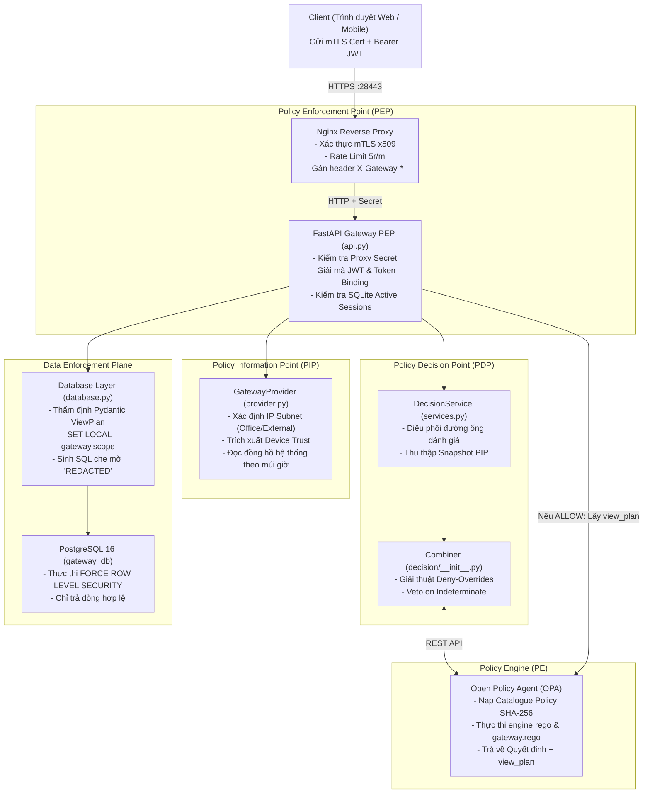

# Zero Trust ABAC Enterprise Data Gateway (v4.0)

[](https://csrc.nist.gov/publications/detail/sp/800-207/final)
[](https://docs.oasis-open.org/xacml/3.0/xacml-3.0-core-spec-os.html)
[](https://datatracker.ietf.org/doc/html/rfc8705)
[](https://pages.nist.gov/800-63-3/sp800-63b.html)
[](https://www.postgresql.org/docs/current/ddl-rowsecurity.html)

**Nghiên cứu và hiện thực hóa cơ chế ra quyết định truy cập dựa trên thuộc tính và ngữ cảnh trong kiến trúc Zero Trust: Mô hình ABAC, Policy Engine (OPA) và Cổng Dữ liệu Bảo vệ Cấp Dòng (PostgreSQL RLS).**

---

## 📖 MỤC LỤC
1. [Tổng quan Kiến trúc Zero Trust](#-tong-quan-kien-truc-zero-trust)
2. [Nguyên lý An ninh Cốt lõi](#-nguyen-ly-an-ninh-cot-loi)
3. [Sơ đồ Phân định Thực thể (NIST SP 800-207)](#-so-do-phan-dinh-thuc-the-nist-sp-800-207)
4. [Sơ đồ Hạ tầng Vi phân đoạn Container (Micro-segmentation)](#-so-do-ha-tang-vi-phan-doan-container-micro-segmentation)
5. [Cơ chế Nghĩa vụ (Obligations) & PostgreSQL RLS](#-co-che-nghia-vu-obligations--postgresql-rls)
6. [Hệ thống 12 Chính sách Doanh nghiệp (P01–P12)](#-he-thong-12-chinh-sach-doanh-nghiep-p01p12)
7. [Hướng dẫn Khởi chạy & Vận hành Nhanh](#-huong-dan-khoi-chay--van-hanh-nhanh)
8. [Danh bạ Tài khoản Mẫu & Phân quyền](#-danh-ba-tai-khoan-mau--phan-quyen)
9. [Kịch bản Kiểm thử & Minh chứng An ninh (Test Cases)](#-kich-ban-kiem-thu--minh-chung-an-ninh-test-cases)
10. [Bản đồ Cấu trúc Dự án (Repository Roadmap)](#-ban-do-cau-truc-du-an-repository-roadmap)

---

## 🛡️ TỔNG QUAN KIẾN TRÚC ZERO TRUST

Mô hình an ninh truyền thống dựa trên "Bức tường phòng thủ chu vi" (Perimeter Security) giả định rằng bất kỳ ai đã lọt vào mạng nội bộ (mạng LAN/VPN) đều đáng tin cậy. Mô hình này đã hoàn toàn thất bại trước các cuộc tấn công di chuyển ngang (Lateral Movement) và đánh cắp thông tin xác thực.

Hệ thống **ABAC Enterprise Data Gateway** hiện thực hóa triệt để 7 nguyên tắc vàng của **NIST SP 800-207**:
1. **Không ngầm định tin cậy bất kỳ ai:** Không tin cậy IP, không tin cậy thiết bị, không tin cậy người dùng kể cả khi đang kết nối từ mạng nội bộ công ty.
2. **Xác thực và ủy quyền liên tục (Continuous Evaluation):** Mọi request đọc dữ liệu đều được đánh giá lại toàn diện theo thời gian thực (Real-time Context Evaluation).
3. **Đặc quyền tối thiểu (Least Privilege):** Chỉ cấp đúng dữ liệu cần thiết theo phòng ban (Row-Level Security) và che mờ các trường nhạy cảm (Column Masking).
4. **Cách ly dữ liệu sâu (Defense-in-Depth):** Bảo vệ đa tầng từ tầng Transport (mTLS x509), tầng Gateway (FastAPI PEP), tầng Quyết định (OPA Rego PDP) đến tầng Nhân cơ sở dữ liệu (PostgreSQL RLS).

---

## 🔒 NGUYÊN LÝ AN NINH CỐT LÕI

| Cơ chế | Tiêu chuẩn / Giải thuật | Ý nghĩa trong Gateway |
|---|---|---|
| **Bảo mật Mật khẩu** | `PBKDF2-HMAC-SHA256` (600.000 vòng) | Chống dò mật khẩu (Brute-force) và GPU Rainbow Table. Chống Timing Attack bằng hàm băm giả định `dummy_hash`. |
| **Gắn kết Token Phần cứng** | RFC 8705 (Token Binding) | Nhúng số Serial chứng chỉ mTLS vào JWT claims (`device_serial`). Trộm token sang máy khác sẽ bị từ chối ngay lập tức. |
| **Quản lý Phiên Động** | Dynamic SQLite Session Store | Khắc phục điểm yếu phi trạng thái của JWT. Hỗ trợ thu hồi phiên tức thì (Instant Revocation/Logout) bằng cách tra cứu SHA-256 của `jti`. |
| **Chống Giả mạo Ngữ cảnh** | Server-side Observation (PIP) | Client không được tự khai báo vị trí hay thời gian. IP, mTLS serial, thời gian thực đều do Nginx và Gateway đo đạc khách quan. |
| **Đóng An toàn (Fail-Closed)** | Default Deny & Veto on Indeterminate | Nếu OPA sập, mạng nghẽn, hoặc lỗi cấu hình $\rightarrow$ Hệ thống lập tức trả về `DENY`, không bao giờ mở cửa hé lộ dữ liệu. |
| **Che mờ Dữ liệu Tầng SQL** | Dynamic SQL Redaction | Dùng `'REDACTED'::text AS column`. Dữ liệu nhạy cảm (Lương, CMND, Email) bị thay thế ngay tại PostgreSQL, không bao giờ vào RAM của Python hay Log ứng dụng. |

---

## 🏛️ SƠ ĐỒ PHÂN ĐỊNH THỰC THỂ (NIST SP 800-207)



---

## 🌐 SƠ ĐỒ HẠ TẦNG VI PHÂN ĐOẠN CONTAINER (MICRO-SEGMENTATION)

Dự án sử dụng cơ chế vi phân đoạn mạng cô lập 4 tầng bằng Docker Compose:

```
[ INTERNET / MẠNG NGOÀI ]
         │
         │  Cổng mở duy nhất: https://127.0.0.1:28443
         ▼
┌─────────────────────────────────────────────────────────────┐
│  Mạng edge (Publicly Accessible)                            │
│  ┌───────────────────────────────────────────────────────┐  │
│  │  Container: proxy (nginx:1.28-alpine)                 │  │
│  │  - SSL Termination & mTLS Verification                │  │
│  │  - Rate Limiting: 5 requests/min trên /auth/login     │  │
│  └───────────────────────────┬───────────────────────────┘  │
└──────────────────────────────┼──────────────────────────────┘
                               │  Chuyển tiếp nội bộ kèm
                               │  X-Gateway-Proxy-Secret
                               ▼
┌─────────────────────────────────────────────────────────────┐
│  Mạng backend (internal: true - CÔ LẬP HOÀN TOÀN)            │
│                                                             │
│  ┌───────────────────────────┐   ┌───────────────────────┐  │
│  │ Container: gateway        │   │ Container: opa        │  │
│  │ (Python FastAPI PEP)      │◄─►│ (openpolicyagent:1.4) │  │
│  │ Port 8000 nội bộ          │   │ Port 8181 nội bộ      │  │
│  └─────────────┬─────────────┘   └───────────────────────┘  │
│                │                                            │
│                ▼                                            │
│  ┌───────────────────────────┐                              │
│  │ Container: postgres       │                              │
│  │ (PostgreSQL 16 + RLS)     │                              │
│  │ Port 5432 nội bộ          │                              │
│  └───────────────────────────┘                              │
└─────────────────────────────────────────────────────────────┘
```

> [!IMPORTANT]
> **Quy tắc an ninh cốt tử:** Cả 3 container `gateway`, `opa`, và `postgres` đều nằm sâu trong mạng `backend: internal: true`. Kẻ tấn công trên mạng LAN dù có quét cổng (Port scan) cũng không thể nhìn thấy OPA (8181), PostgreSQL (5432) hay FastAPI (8000). Mọi truy cập bắt buộc phải qua cổng 443 của Nginx có kèm chứng chỉ máy khách mTLS!

---

## 🎯 CƠ CHẾ NGHĨA VỤ (OBLIGATIONS) & POSTGRESQL RLS

Tại sao OPA lại sinh `view_plan` thay vì để PostgreSQL tự làm toàn bộ?
* **PE (OPA) là BỘ NÃO QUYẾT ĐỊNH:** OPA nắm toàn bộ luật kinh doanh và ngữ cảnh (ai là admin, ai là engineer, clearance nào, giờ hành chính ra sao). Khi cho phép (`ALLOW`), OPA ban hành **Nghĩa vụ (Obligation)** quy định: *User này chỉ được xem phòng ban nào (`row_scope`) và phải che mờ những cột nào (`mask`)*.
* **PostgreSQL là CƠ BẮP THỰC THI:** PostgreSQL cung cấp cơ chế bảo vệ cấp dòng (Row-Level Security). Gateway nhận `view_plan` từ OPA rồi tiêm vào giao dịch:
  ```sql
  SET LOCAL statement_timeout = '3s';
  SELECT set_config('gateway.scope', 'department', true),
         set_config('gateway.department', 'engineering', true);
  ```
* **Chính sách RLS trong PostgreSQL ([scripts/gateway_rls.sql](file:///run/media/tamdae/04C8A69DC8A68C8C/Users/LENOVO/Documents/TL_Kỳ_1_năm_4/Data_Security/rebuild/scripts/gateway_rls.sql)):**
  ```sql
  CREATE POLICY gateway_scope ON customer_data FOR SELECT TO gateway_reader
   USING (current_setting('gateway.scope', true) = 'all' OR
          (current_setting('gateway.scope', true) = 'department' AND
           department = current_setting('gateway.department', true)));
  ```
  Nếu không có biến session hợp lệ, hàm `current_setting(..., true)` trả về `NULL` $\rightarrow$ Điều kiện sai $\rightarrow$ **PostgreSQL chặn đứng và trả về 0 dòng (Fail-Closed)**!

---

## 📜 HỆ THỐNG 12 CHÍNH SÁCH DOANH NGHIỆP (P01–P12)

Được định nghĩa tại [policies/policies.json](file:///run/media/tamdae/04C8A69DC8A68C8C/Users/LENOVO/Documents/TL_Kỳ_1_năm_4/Data_Security/rebuild/policies/policies.json) và đánh giá bằng OPA Rego:

| ID | Hiệu lực | Điều kiện áp dụng | Rationale (Căn cứ an ninh) |
|---|---|---|---|
| **P01** | `PERMIT` | Role: `admin` | Quản trị viên hệ thống có toàn quyền đọc mọi nguồn dữ liệu. |
| **P02** | `PERMIT` | Role: `security_auditor`, Resource: `production` | Kiểm toán viên an ninh được phép đọc nhật ký sản xuất để phục vụ điều tra. |
| **P03** | `PERMIT` | Role: `marketing_analyst`, Dept: `marketing`, Resource: `customers` | Phân tích viên tiếp thị được xem dữ liệu khách hàng (sẽ bị che mờ lương/CCCD). |
| **P04** | `PERMIT` | Role: `data_engineer`, Dept: `data`, Resource: `customers` | Kỹ sư dữ liệu được xem khách hàng phục vụ bảo trì đường ống dữ liệu. |
| **P05** | `PERMIT` | Role: `risk_analyst`, Dept: `finance`, Resource: `financial` | Chuyên viên quản trị rủi ro được xem báo cáo tài chính nội bộ. |
| **P06** | `PERMIT` | Role: `compliance_officer`, Resource: `customers` | Cán bộ tuân thủ được duyệt dữ liệu khách hàng để kiểm tra tính hợp chuẩn. |
| **P07** | `DENY` | Location != `office` (Địa điểm ngoài văn phòng) | Chặn truy cập từ xa ngoài dải mạng văn phòng hợp chuẩn. |
| **P08** | `DENY` | Device_trusted == `false` (Thiết bị không tin cậy) | Chặn ngay lập tức các thiết bị chưa được cài chứng chỉ mTLS hoặc bị nhiễm mã độc. |
| **P09** | `DENY` | Risk_score > `70` (Điểm rủi ro cao) | Chặn mọi hành vi bất thường vượt ngưỡng an toàn của hệ thống. |
| **P10** | `DENY` | Time < `08:00` (Trước giờ làm việc) | Giới hạn khung giờ hành chính (Asia/Bangkok), ngăn chặn truy cập đêm khuya. |
| **P11** | `DENY` | Time > `18:00` (Sau giờ làm việc) | Hết giờ làm việc, tự động ngắt quyền truy cập tài nguyên mật. |
| **P12** | `DENY` | Clearance < Resource Classification Level | Hạn mức bảo mật người dùng thấp hơn độ mật tài nguyên (`rank_lt`). |

> [!NOTE]
> **Thuật toán Kết hợp Deny-Overrides:**
> - Nếu **BẤT KỲ** chính sách `DENY` nào khớp (P07–P12) $\rightarrow$ Quyết định cuối cùng là **DENY**.
> - Nếu có ít nhất một chính sách `PERMIT` khớp và **KHÔNG CÓ** chính sách Deny nào $\rightarrow$ Quyết định là **ALLOW**.
> - Nếu không có chính sách nào khớp $\rightarrow$ Quyết định là **DENY** (Default Deny).
> - Nếu có lỗi bất định / timeout OPA $\rightarrow$ Quyết định là **DENY** (Veto on Indeterminate).

---

## 🚀 HƯỚNG DẪN KHỞI CHẠY & VẬN HÀNH NHANH

### 1. Yêu cầu Tiên quyết
- Hệ điều hành: Linux, macOS hoặc Windows (WSL2).
- Đã cài đặt: **Docker**, **Docker Compose**, **Python 3.10+**.

### 2. Thiết lập Môi trường & Khởi tạo Hạ tầng Mật mã PKI
Tại thư mục gốc `rebuild/`, chạy lệnh cấu hình một lần duy nhất:

```bash
# Cài đặt thư viện hỗ trợ sinh chứng chỉ cục bộ
python3 -m pip install cryptography psycopg[binary] pydantic

# Khởi tạo Root CA, chứng chỉ Server/Client và sinh các mã bí mật
python3 scripts/setup_gateway.py --hosts localhost 127.0.0.1
```
Lệnh này sẽ tự động:
1. Tạo thư mục ẩn `.gateway/` chứa Root CA (`ca.key`, `ca.crt`), Server cert (`server.key`, `server.crt`).
2. Sinh chứng chỉ máy khách mTLS `company-device` và `unregistered-device`.
3. Sinh file biến môi trường bảo mật `.gateway/gateway.env` chứa các mật khẩu ngẫu nhiên độc lập.
4. Sinh file tài khoản và mật khẩu đăng nhập tại `.gateway/credentials.json`.

### 3. Đóng gói Chứng chỉ Trình duyệt (.p12) cho Client
Để truy cập từ trình duyệt (Chrome / Edge / Firefox) hoặc điện thoại, bạn xuất file PKCS#12:

```bash
python3 scripts/enroll_device.py --device-name my-laptop
```
File chứng chỉ `my-laptop.p12` và mật khẩu mở khóa sẽ được tạo tại `.gateway/exported_devices/my-laptop/`. Bạn chỉ cần click đúp vào file `.p12` để cài vào hệ điều hành hoặc trình duyệt!

### 4. Khởi động 4 Container Gateway
```bash
./scripts/start.sh
```

### 5. Kiểm tra Trạng thái Sẵn sàng (Health Check)
```bash
curl -k https://127.0.0.1:28443/health
```
Phản hồi thành công:
```json
{"version": "4.0.0", "opa_ready": true, "database_ready": true}
```

### 6. Truy cập Giao diện Người dùng
Mở trình duyệt truy cập: **`https://127.0.0.1:28443/`**
- Chọn chứng chỉ client `company-device` khi trình duyệt hỏi.
- Lấy thông tin đăng nhập từ file `.gateway/credentials.json`.

---

## 👥 DANH BẠ TÀI KHOẢN MẪU & PHÂN QUYỀN

| Tài khoản | Vai trò (Role) | Phòng ban | Clearance | Quyền hạn & Kỳ vọng |
|---|---|---|---|---|
| **admin** | `admin` | data | restricted | Xem được toàn bộ dữ liệu mọi phòng ban, không bị che mờ cột. |
| **engineer** | `data_engineer` | data | restricted | Xem được dữ liệu khách hàng thuộc phòng data, che mờ lương & CCCD. |
| **analyst** | `marketing_analyst` | marketing | confidential | Xem được dữ liệu khách hàng phòng marketing, che mờ lương & CCCD. |
| **finance** | `risk_analyst` | finance | restricted | Xem được báo cáo tài chính phòng finance. |
| **intern** | `intern` | marketing | internal | **BỊ TỪ CHỐI (DENY)**: Hạn mức clearance quá thấp (vi phạm P12). |
| **revoked_user**| `marketing_analyst` | marketing | confidential | **BỊ CHẶN (HTTP 401)**: Tài khoản đã bị khóa (`enabled: false`). |

*(Mật khẩu tương ứng của từng user được sinh ngẫu nhiên tại `.gateway/credentials.json` khi chạy `setup_gateway.py`)*

---

## 🧪 KỊCH BẢN KIỂM THỬ & MINH CHỨNG AN NINH (TEST CASES)

Tất cả các kịch bản kiểm thử mẫu và hướng dẫn chi tiết nằm tại [rebuild/KICH_BAN_KIEM_THU_VA_MINH_CHUNG.md](file:///run/media/tamdae/04C8A69DC8A68C8C/Users/LENOVO/Documents/TL_Kỳ_1_năm_4/Data_Security/rebuild/KICH_BAN_KIEM_THU_VA_MINH_CHUNG.md).

### Tóm tắt các ca kiểm thử tiêu biểu:
1. **Kiểm thử Che mờ Cột (Dynamic Masking):** Đăng nhập `analyst` $\rightarrow$ Truy vấn bảng Khách hàng $\rightarrow$ Kết quả: Các cột `salary`, `email`, `national_id` đều bị đổi thành chuỗi `'REDACTED'`.
2. **Kiểm thử Lọc dòng Cách ly Phòng ban (RLS):** Đăng nhập `analyst` (Marketing) $\rightarrow$ Chỉ thấy các dòng có `department = 'marketing'`, không thể thấy dữ liệu của phòng `risk` hay `finance`.
3. **Kiểm thử Trộm Token sang Máy khác (Hardware Token Binding Attack):** Lấy JWT của máy có mTLS mang sang máy không có mTLS gửi kèm $\rightarrow$ Gateway phát hiện số serial thiết bị không khớp $\rightarrow$ Trả về `HTTP 401 Token device mismatch`.
4. **Kiểm thử Truy cập Ngoài Giờ (Out of Business Hours):** Gửi request sau 18:00 hoặc trước 08:00 $\rightarrow$ Chính sách P10/P11 kích hoạt $\rightarrow$ Trả về `HTTP 403 DENY` với mã `POLICY_DEFAULT_DENY`, trường `db_queried: False`.
5. **Kiểm thử Thiết bị Chưa Ghi danh (Unregistered Device):** Dùng chứng chỉ `unregistered-device` (dù ký bởi đúng Root CA của công ty) $\rightarrow$ Bị từ chối vì không có trong `registry.json`.

---

## 📁 BẢN ĐỒ CẤU TRÚC DỰ ÁN (REPOSITORY ROADMAP)

```
rebuild/
├── app/                            # Mã nguồn ứng dụng Gateway PEP & PDP
│   ├── __init__.py                 # Khởi tạo package
│   ├── jsonio.py                   # Phân tích cú pháp JSON nghiêm ngặt, chống Key Collision
│   ├── models/                     # Data Contracts chuẩn Pydantic (extra="forbid")
│   ├── attribute_provider/         # PIP: Quản lý Snapshots, kiểm tra TTL & Freshness
│   ├── policy_repository.py        # Lưu trữ và băm SHA-256 danh mục chính sách
│   ├── opa_client/                 # HTTP client kết nối OPA, Fail-Closed on timeout
│   ├── decision/                   # Thuật toán Combiner: Deny-Overrides, Veto on Indeterminate
│   ├── services.py                 # Pipeline điều phối quyết định DecisionService
│   └── gateway/                    # Cổng PEP thực thi an ninh dữ liệu
│       ├── security.py             # PBKDF2 600k vòng, JWT Token Binding x509
│       ├── sessions.py             # SQLite Active Session Store, thu hồi phiên tức thì
│       ├── provider.py             # Server-side Context Provider chống giả mạo
│       ├── database.py             # psycopg Connection Pool, SQL Masking & RLS injection
│       └── api.py                  # FastAPI Gateway PEP trung tâm
├── policies/                       # Module chính sách (Policy-as-Code)
│   ├── policies.json               # 12 chính sách doanh nghiệp phân tầng P01–P12
│   ├── engine.rego                 # Bộ máy thực thi ABAC & rank_lt trong OPA
│   └── gateway.rego                # Kế hoạch hiển thị & nghĩa vụ (view_plan Obligations)
├── data/                           # Dữ liệu tĩnh giả lập cho PIP (users, contexts, resources)
├── nginx/                          # Cấu hình Nginx Edge PEP chính thức (mount trực tiếp)
│   ├── nginx.conf                  # Cấu hình Reverse Proxy (mTLS, HSTS, Rate limit 5r/m)
│   ├── proxy-headers.example.conf  # Mẫu header chuyển tiếp bí mật X-Gateway-Proxy-Secret
│   └── README.md                   # Hướng dẫn chi tiết kiến trúc Nginx Edge PEP
├── .gateway.example/               # Thư mục mẫu blueprint cho runtime secrets & PKI
│   ├── gateway.env.example         # Mẫu biến môi trường bảo mật truyền vào Docker
│   ├── credentials.example.json    # Mẫu tài khoản & mật khẩu ngẫu nhiên
│   ├── server/registry.example.json# Mẫu sổ đăng ký mTLS device serial & PBKDF2 hash
│   └── README.md                   # Diễn giải cấu trúc runtime .gateway/
├── ui/gateway/                     # Giao diện Web Client thuần HTML/CSS/JS (Zero-Dependency)
│   ├── index.html                  # Giao diện trực quan, khung hiển thị minh chứng JSON
│   ├── gateway.css                 # Định kiểu trạng thái ALLOW/DENY & Mobile Responsive
│   └── gateway.js                  # Bộ điều khiển client lưu JWT trong RAM, chống XSS
├── scripts/                        # Bộ công cụ tự động hóa PKI, SQL & Vận hành
│   ├── setup_gateway.py            # Master PKI: Tự động sinh Root CA, Certs, Passwords, .p12
│   ├── enroll_device.py            # Đăng ký thiết bị mTLS mới & xuất file PKCS#12
│   ├── add_accounts.py             # Bổ sung tài khoản kiểm thử bảo mật (intern, risk, revoked)
│   ├── start.sh / stop.sh          # Kịch bản khởi chạy tự động (auto-provision) và dừng cụm
│   ├── renew_gateway_server.py     # Tự động cấp lại cert TLS khi đổi IP mạng LAN/Wi-Fi
│   ├── init_gateway_db.sql         # Khởi tạo bảng dữ liệu nghiệp vụ giả lập
│   ├── gateway_rls.sql             # Kích hoạt & áp dụng bắt buộc Row-Level Security (RLS)
│   └── init_gateway_role.sh        # Thiết lập role gateway_reader đặc quyền tối thiểu (PoLP)
├── tests/                          # Bộ kiểm chuẩn an ninh tự động
│   ├── unit/                       # Kiểm thử Data Contracts & Thuật toán PBKDF2
│   ├── integration/                # Kiểm thử tích hợp Gateway mTLS & luồng ABAC
│   ├── failure/                    # Kiểm thử khả năng chịu lỗi Đóng An toàn (Fail-Closed)
│   └── policy_matrix/              # Ma trận kiểm thử toàn diện 12 chính sách P01–P12
├── Dockerfile.gateway              # Đóng gói Gateway: --no-proxy-headers & --no-access-log
├── compose.gateway.yml             # Cấu hình vi phân đoạn 4 container Docker (edge vs backend)
├── requirements-lock.txt           # Khóa cứng phiên bản phụ thuộc chuỗi cung ứng
├── requirements-gateway.txt        # Thư viện runtime của Gateway
└── pyproject.toml                  # Cấu hình gói và metadata dự án
```

---

## ⚖️ GIẤY PHÉP & BẢN QUYỀN
Đồ án môn học An toàn Dữ liệu & Nghiên cứu Kiến trúc Zero Trust.
Mọi thành phần mã nguồn được thiết kế theo các tiêu chuẩn mở quốc tế (NIST, OASIS, IETF).
