# Zero Trust ABAC Enterprise Data Gateway (v4.0)

[](https://csrc.nist.gov/publications/detail/sp/800-207/final)
[](https://docs.oasis-open.org/xacml/3.0/xacml-3.0-core-spec-os.html)
[](https://datatracker.ietf.org/doc/html/rfc8705)
[](https://www.postgresql.org/docs/current/ddl-rowsecurity.html)
[](https://www.openpolicyagent.org/)

Hệ thống Cổng Dữ liệu Doanh nghiệp bảo vệ cấp dòng (Row-Level Security) và che mờ dữ liệu động (Dynamic Data Masking) theo kiến trúc **Zero Trust (NIST SP 800-207)**, kết hợp kiểm soát truy cập dựa trên thuộc tính (**ABAC**) và động cơ chính sách **Open Policy Agent (OPA)**.

---

## 🏛️ SƠ ĐỒ KIẾN TRÚC TỔNG QUAN

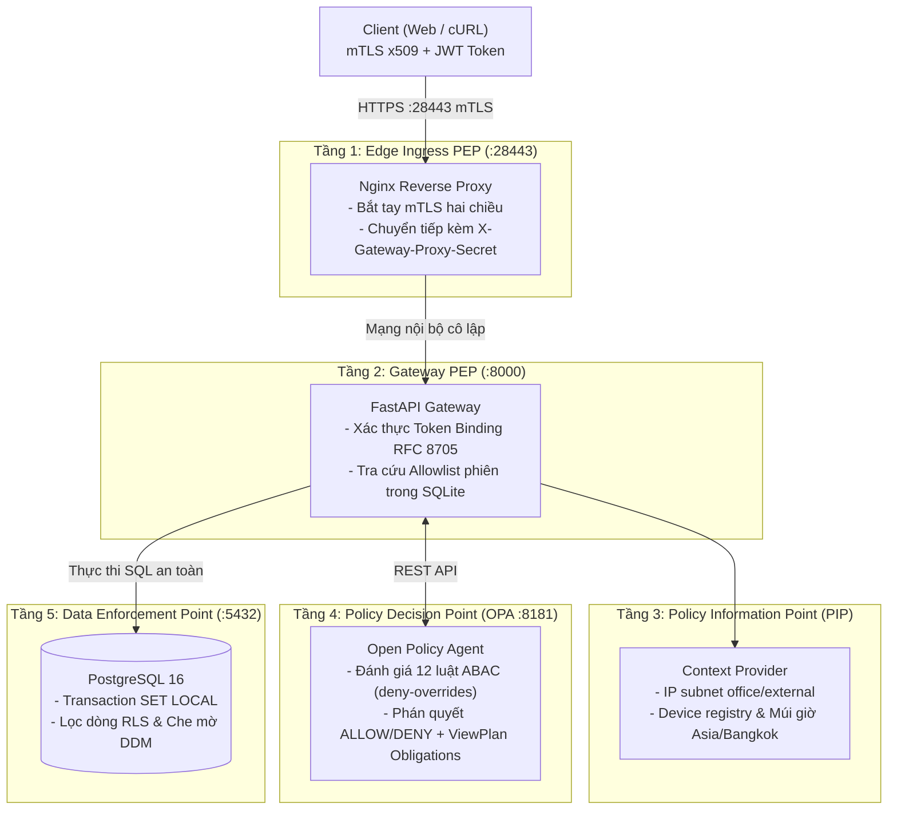

---

## 🚀 HƯỚNG DẪN KHỞI CHẠY NHANH

### 1. Khởi tạo Hạ tầng Mật mã PKI & Mật khẩu
Chạy lệnh cấu hình một lần:
```bash
python3 scripts/setup_gateway.py --hosts localhost 127.0.0.1
```
Lệnh sẽ tự động sinh Root CA, chứng chỉ Server/Client mTLS, mật khẩu PBKDF2 600.000 vòng và lưu vào thư mục ẩn `.gateway/`.

### 2. Khởi động Cụm 4 Container Docker
```bash
./scripts/start.sh
```
Kiểm tra trạng thái sẵn sàng (Healthcheck):
```bash
curl -k https://127.0.0.1:28443/health
# {"version":"4.0.0","opa_ready":true,"database_ready":true}
```

### 3. Đóng gói Chứng chỉ Trình duyệt (.p12)
Để truy cập giao diện Web Client từ trình duyệt:
```bash
python3 scripts/enroll_device.py --device-name my-laptop
```
File `my-laptop.p12` và mật khẩu mở khóa sẽ được lưu tại `.gateway/exported_devices/my-laptop/`. Cài file này vào trình duyệt rồi truy cập `https://127.0.0.1:28443/`.

### 4. Dừng Cụm Dịch vụ
```bash
./scripts/stop.sh
```

---

## 👥 DANH BẠ TÀI KHOẢN MẪU & MẬT KHẨU

Các tài khoản phục vụ kiểm thử an ninh được trích xuất từ `.gateway/credentials.json`:

| Tài khoản | Mật khẩu mặc định | Vai trò (Role) | Phòng ban | Quyền hạn truy cập |
|---|---|---|---|---|
| **admin** | `3fIhpPm7pAgpVf1lDqMmgBNB` | `admin` | data | Toàn quyền xem mọi bản ghi, không bị che mờ dữ liệu. |
| **analyst** | `yjn50f1LtUf3iU5YskgAsXme` | `marketing_analyst` | marketing | Chỉ xem khách hàng phòng Marketing; email, lương, CMND bị che `'REDACTED'`. |
| **engineer** | `VV3XeyOb0WrlTBHU5Flr-VXd` | `data_engineer` | data | Xem dữ liệu kỹ thuật và sản xuất; bị chặn khi đọc chéo phòng ban khác. |

---

## 🧪 7 KỊCH BẢN KIỂM CHỨNG THỰC NGHIỆM AN NINH

### Kịch bản 1: Phân quyền Dữ liệu Cấp dòng (RLS) & Che mờ Cột Nhạy cảm (DDM)
* **Vấn đề an ninh:** Hai người dùng thuộc hai vai trò khác nhau cùng truy cập tài nguyên `Customers`. Hệ thống phải phân định dữ liệu: tài khoản quản trị được xem toàn bộ dữ liệu thật, trong khi nhân viên phân tích chỉ được xem dữ liệu thuộc phòng ban của mình và các thông tin nhạy cảm (email, lương, số định danh) bắt buộc phải bị che mờ trực tiếp tại nhân cơ sở dữ liệu.
* **Minh chứng thực nghiệm:**

*Tài khoản Admin nhận toàn bộ 3 khách hàng với dữ liệu thô nguyên vẹn:*
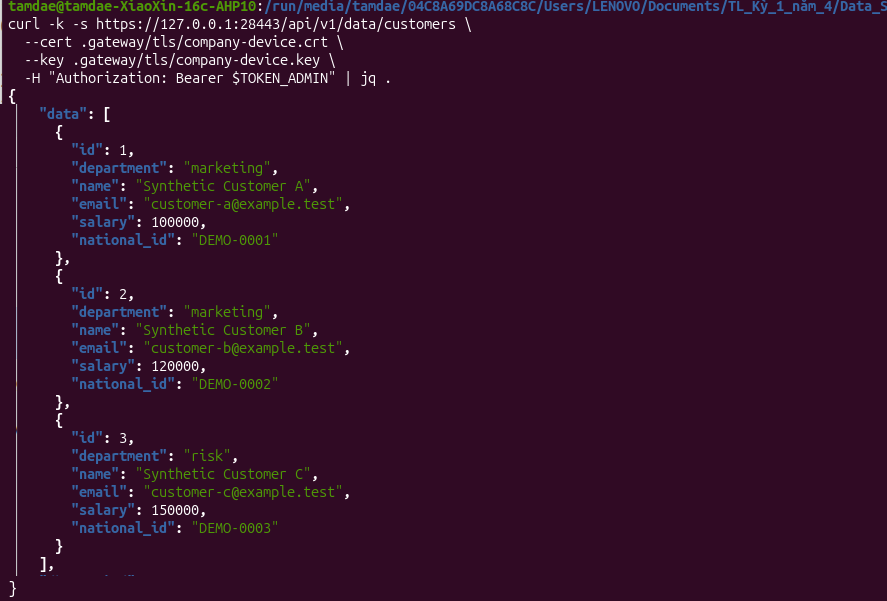

*Tài khoản Analyst chỉ nhận được 2 khách hàng Marketing; các trường email, lương, số định danh bị che thành 'REDACTED':*
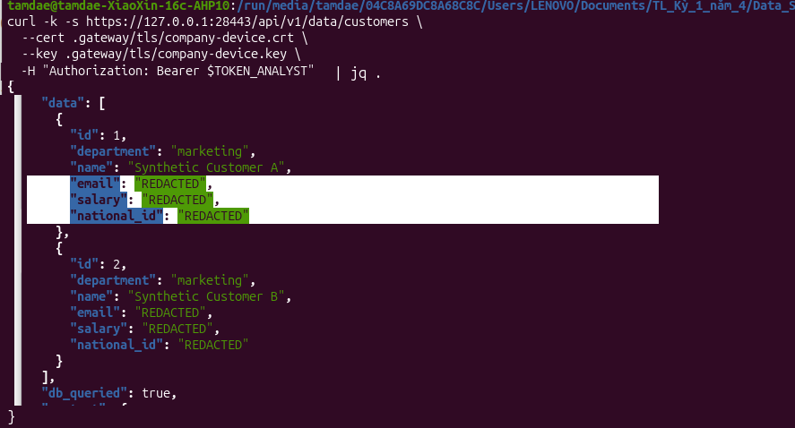

---

### Kịch bản 2: Kiểm soát Thiết bị mTLS và Ràng buộc Mã Token (Token Binding RFC 8705)
* **Vấn đề an ninh:** Kẻ tấn công đánh cắp được chuỗi JWT token hợp lệ của máy công ty rồi mang sang máy cá nhân hoặc kết nối không có chứng chỉ mTLS để gọi API hòng chiếm đoạt dữ liệu. Gateway phải phát hiện sự sai lệch vân tay chứng chỉ và hủy yêu cầu ngay lập tức.
* **Minh chứng thực nghiệm:**

*Sử dụng token hợp lệ nhưng kết nối không xuất trình chứng chỉ mTLS $\rightarrow$ Bị chặn với HTTP 401 Unauthorized:*
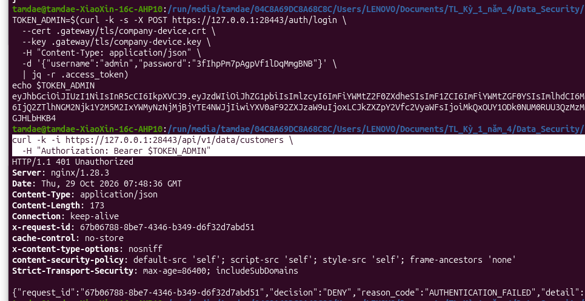

*Sử dụng chứng chỉ lạ chưa đăng ký trong danh bạ $\rightarrow$ OPA kích hoạt P08 từ chối với HTTP 403 UNTRUSTED_DEVICE:*
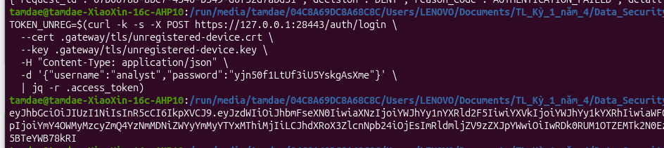

---

### Kịch bản 3: Xung đột Chính sách và Thuật toán Deny-Overrides
* **Vấn đề an ninh:** Người dùng có vai trò hợp lệ để đọc dữ liệu (khớp quy tắc Cho phép), nhưng lại vi phạm một điều cấm an ninh (như đăng nhập ngoài giờ làm việc hoặc thiết bị chưa được tin cậy). Hệ thống phải xử lý xung đột theo nguyên tắc Deny-Overrides: bất kỳ quy định Cấm nào kích hoạt đều phủ quyết toàn bộ quyền cho phép.
* **Minh chứng thực nghiệm:**

*Chính sách P08 (Deny) kích hoạt và phủ quyết chính sách P01 (Permit):*
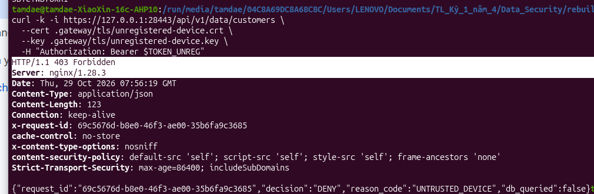

*Hệ thống trả về phán quyết DENY với HTTP 403 Forbidden, bảo đảm an toàn tuyệt đối:*
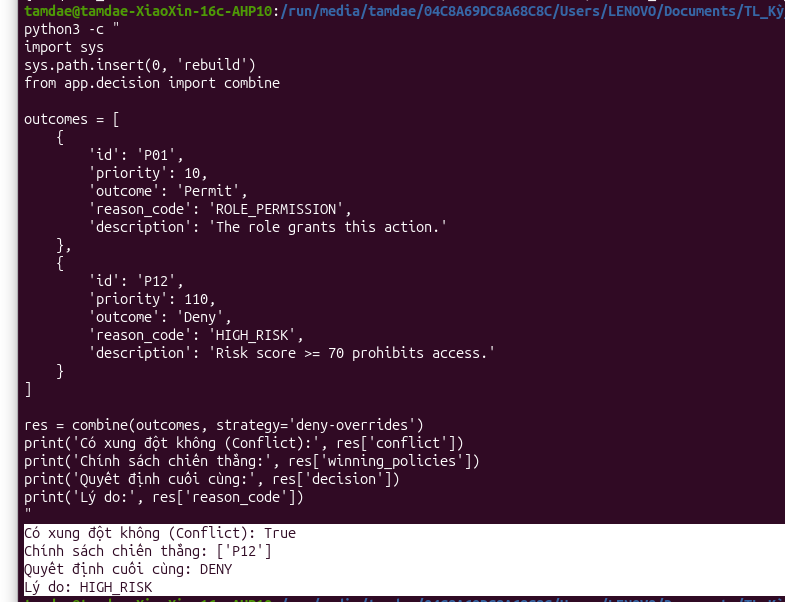

---

### Kịch bản 4: Cơ chế Tự bảo vệ Đóng An toàn (Fail-Closed) khi OPA Gặp Sự cố
* **Vấn đề an ninh:** Động cơ chính sách OPA bị sập đột ngột hoặc mất kết nối mạng. Hệ thống tuyệt đối không được tự ý cấp quyền mặc định hay để lọt dữ liệu thô ra ngoài khi chưa có phán quyết an ninh đáng tin cậy.
* **Minh chứng thực nghiệm:**

*Chủ động dừng container OPA bằng lệnh `docker stop`:*
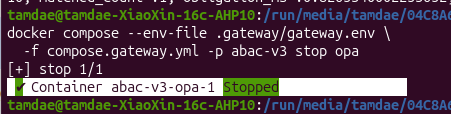

*Gateway lập tức ngắt mạch an toàn, trả về HTTP 503 OPA_UNAVAILABLE, cờ `db_queried = false` khẳng định CSDL không bị chạm tới:*
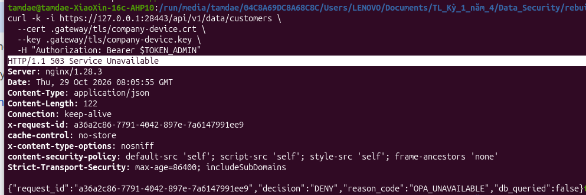

---

### Kịch bản 5: Phòng chống Giả mạo Thông tin Thiết bị (Header Spoofing Attack)
* **Vấn đề an ninh:** Kẻ tấn công tự ý chèn các Header HTTP giả mạo (`X-Gateway-Device-Verified: SUCCESS`, `X-Gateway-Device-Serial`, `X-Forwarded-For`) nhằm mạo danh thiết bị của Tổng Giám đốc hoặc dải mạng văn phòng. Cổng tiếp nhận Nginx phải làm sạch toàn bộ header tự khai trước khi chuyển tiếp.
* **Minh chứng thực nghiệm:**

*Các Header giả mạo bị Nginx xóa sạch; Gateway nhận diện kết nối vật lý không có chứng chỉ và từ chối HTTP 403 UNTRUSTED_DEVICE:*
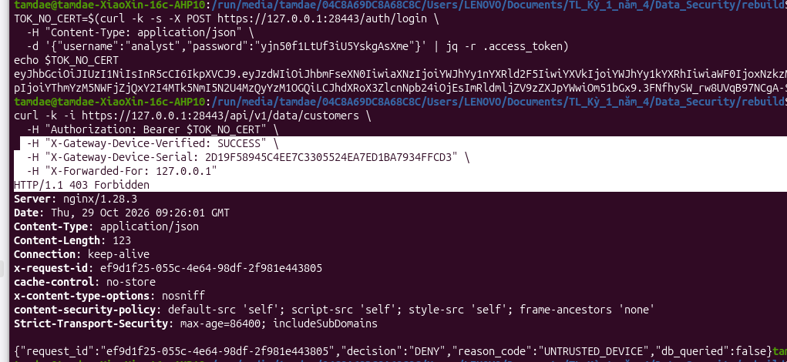

---

### Kịch bản 6: Kiểm soát Truy cập Phân tách theo Phòng ban (Department Isolation)
* **Vấn đề an ninh:** Tài khoản Kỹ sư (`engineer` thuộc phòng Kỹ thuật) cố tình truy cập tài nguyên dữ liệu khách hàng phòng Tiếp thị (`customers`). OPA phải ngăn chặn triệt để hành vi truy cập chéo phòng ban trái phép.
* **Minh chứng thực nghiệm:**

*Yêu cầu bị từ chối với HTTP 403 Forbidden và lý do DEPARTMENT_MISMATCH:*
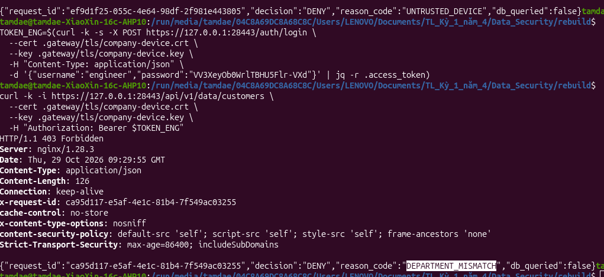

---

### Kịch bản 7: Phòng chống Tham số Điều khiển Phi chuẩn (URL Tampering)
* **Vấn đề an ninh:** Kẻ tấn công cố tình chèn thêm query parameters trên URL (ví dụ: `?strategy=permit-overrides&override=true`) nhằm ép buộc Gateway đổi thuật toán xét quyền sang chế độ nới lỏng để hưởng lợi.
* **Minh chứng thực nghiệm:**

*Gateway PEP chặn đứng ngay tại tầng biên với HTTP 422 Unprocessable Entity và lý do INVALID_REQUEST:*
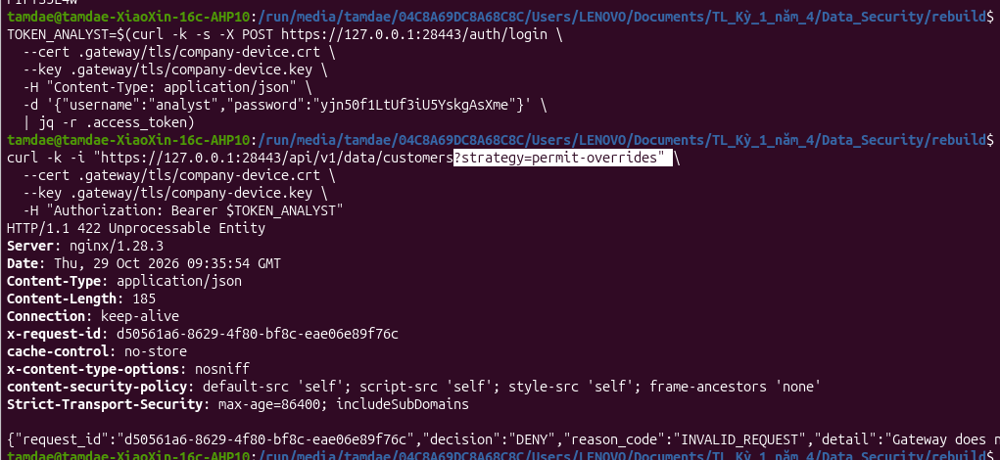

---

## 📊 ĐỊNH LƯỢNG HIỆU NĂNG & ĐO LƯỜNG BENCHMARK

Hệ thống được đo tải tự động qua 9 kịch bản ma trận bằng script `python3 scripts/benchmark_stress_matrix.py`:

### 1. Ma trận Hiệu năng Tổng thể (Quy mô Chính sách $\times$ Tải trọng)

| Quy mô chính sách | Tải trọng (req/s) | Thông lượng thực tế (RPS) | Độ trễ $P_{50}$ (ms) | Độ trễ $P_{95}$ (ms) | Tỷ lệ lỗi / quá hạn (%) |
|:---:|:---:|:---:|:---:|:---:|:---:|
| **50 luật** | 10 | 9,9 | 10,35 | 13,45 | **0,00%** |
| **50 luật** | 100 | 94,2 | 8,47 | 11,77 | **0,00%** |
| **50 luật** | 1.000 | **216,2** | 1.002,25 | 1.111,19 | **0,00%** |
| **500 luật** | 10 | 9,9 | 41,60 | 46,34 | **0,00%** |
| **500 luật** | 100 | 78,0 | 518,33 | 819,55 | **0,00%** |
| **500 luật** | 1.000 | 70,1 | 4.098,95 | 4.436,20 | **0,00%** |
| **5.000 luật** | 10 | 8,9 | 557,21 | 618,09 | **0,00%** |
| **5.000 luật** | 100 | 24,8 | 10.009,19 | 17.778,77 | **42,64%** |
| **5.000 luật** | 1.000 | 38,4 | 21.764,19 | 24.377,02 | **60,52%** |

*Tỷ lệ lỗi do quá hạn thời gian (Timeout) khi hệ thống nạp 5.000 chính sách:*
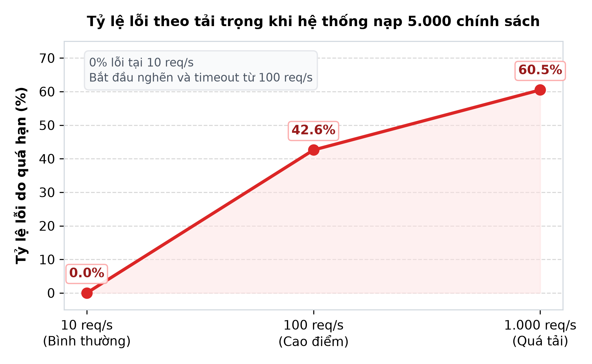

---

### 2. Bóc tách Độ trễ 4 Tầng Kiến trúc tại $P_{50}$ (Đại diện 500 Chính sách)

| Tầng kiến trúc | Thành phần đảm nhiệm | Thời gian trễ $P_{50}$ (ms) | Tỷ trọng |
|---|---|:---:|:---:|
| **Tầng 1** | Kênh truyền mTLS & Ingress Nginx | 132,6 ms | ~28% |
| **Tầng 2** | Gateway PEP nội tại (Token & Session) | 21,5 ms | ~4% |
| **Tầng 3** | **Bộ xét quyền OPA PDP (Điểm nghẽn chính)** | **300,8 ms** | **~63%** |
| **Tầng 4** | Cơ sở dữ liệu PostgreSQL DEP (RLS + DDM) | 21,7 ms | ~5% |

*Bóc tách độ trễ 4 tầng tại quy mô 500 chính sách (OPA là điểm nghẽn tính toán chính):*
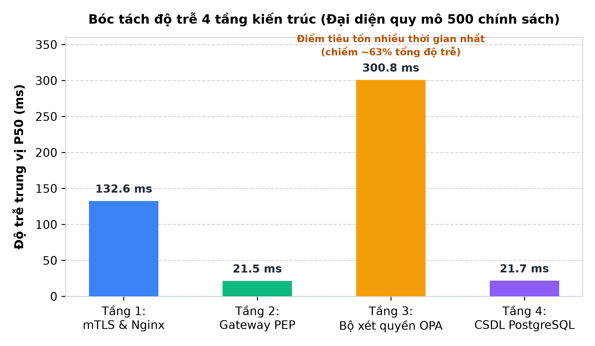

---

### 3. Hiệu quả của Cơ chế Từ chối Sớm (ALLOW vs EARLY DENY)

Khi yêu cầu vi phạm chính sách (ví dụ: thiết bị lạ không có mTLS), Gateway ngắt mạch ngay sau OPA và trả về HTTP 403, hoàn toàn không gọi sang CSDL ($t_{\text{DB}} = 0\text{ ms}$):

| Đường xử lý | Độ trễ $P_{50}$ (ms) | Độ trễ $P_{95}$ (ms) | Có truy vấn CSDL? | Kết quả |
|---|:---:|:---:|:---:|:---:|
| **Cho phép (ALLOW)** | 518,3 ms | 819,5 ms | Có (Lọc dòng + Che cột) | `HTTP 200` |
| **Từ chối sớm (EARLY DENY)** | **81,1 ms** | **178,2 ms** | **Không (0 ms)** | `HTTP 403` |

*Luồng Từ chối sớm nhanh hơn **6,4 lần** và bảo vệ CSDL hoàn toàn:*
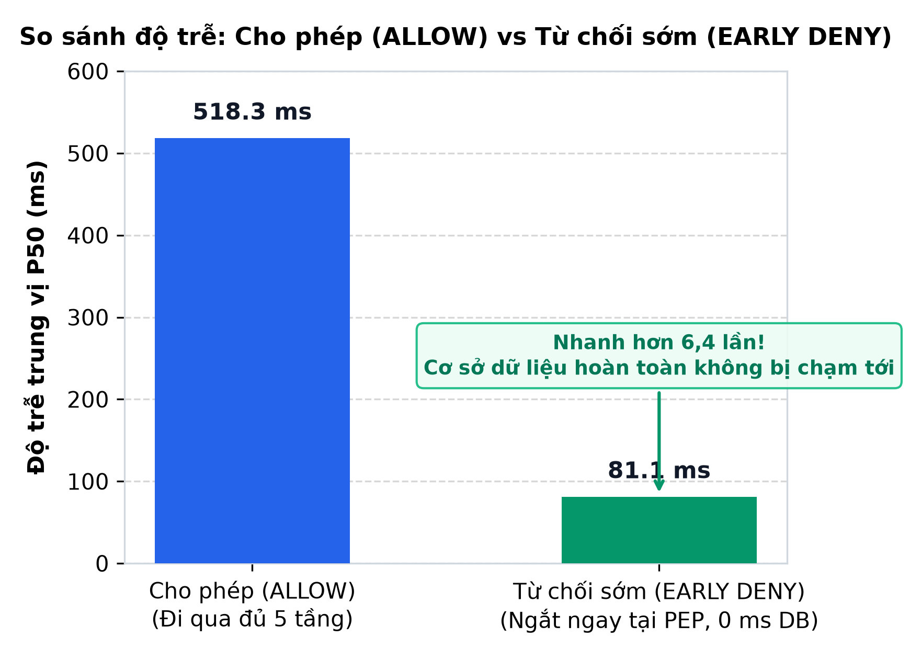

---

### 4. Kết luận Điểm nghẽn Cốt lõi
* **OPA PDP là điểm nghẽn tính toán lớn nhất:** Thời gian duyệt luật tăng tuyến tính $O(N)$ theo CPU đơn luồng (từ 3 ms ở 50 luật lên 300 ms ở 500 luật và >2 giây ở 5.000 luật).
* **Nginx Socket Backlog là điểm nghẽn hàng đợi:** Khi tải dồn dập 1.000 req/s, yêu cầu bị xếp hàng trong bộ đệm kết nối TCP của Nginx trong lúc chờ Gateway xử lý.
* **PostgreSQL DEP vận hành cực nhanh:** Thời gian lọc dòng RLS và che mờ DDM luôn ổn định dưới **1 ms** ở tải bình thường và hoàn toàn độc lập với quy mô chính sách OPA.
* **Cơ chế Early Deny bảo vệ CSDL:** Ngắt truy cập ngay tại biên giúp giảm độ trễ gấp 6,4 lần, ngăn chặn triệt để nguy cơ quá tải CSDL trước các đợt quét cổng hoặc tấn công từ chối dịch vụ.

---

## 🔌 DANH MỤC API ENDPOINTS CÔNG KHAI

Tất cả yêu cầu được định tuyến qua cổng HTTPS an toàn `https://127.0.0.1:28443`:

| Phương thức | Endpoint | Xác thực | Chức năng |
|---|---|---|---|
| `GET` | `/health` | Public | Kiểm tra trạng thái hoạt động của OPA và PostgreSQL. |
| `GET` | `/` | mTLS | Giao diện Web Client Zero-Trust trực quan. |
| `POST` | `/auth/login` | mTLS + Rate limit | Đăng nhập tài khoản, gắn Token Binding số Serial chứng chỉ mTLS (RFC 8705). |
| `POST` | `/auth/logout` | Bearer Token | Thu hồi phiên làm việc tức thì trong bảng SQLite (Instant Revocation). |
| `GET` | `/api/v1/data/customers` | Bearer Token + mTLS | Đọc dữ liệu Khách hàng: Lọc dòng RLS và che mờ DDM các cột nhạy cảm. |
| `GET` | `/api/v1/data/financial` | Bearer Token + mTLS | Đọc hồ sơ Tài chính doanh nghiệp (Yêu cầu phòng `finance` và clearance `restricted`). |
| `GET` | `/api/v1/data/production` | Bearer Token + mTLS | Đọc nhật ký Sản xuất hạ tầng (Dành cho `admin` và `data_engineer`). |


---

## 📁 CẤU TRÚC THƯ MỤC DỰ ÁN

```
rebuild/
├── app/                            # Mã nguồn ứng dụng Gateway PEP & PDP
│   ├── models/                     # Data Contracts chuẩn Pydantic (Strict validation)
│   ├── attribute_provider/         # PIP: Quản lý Snapshots, kiểm tra bối cảnh
│   ├── policy_repository.py        # Lưu trữ và băm SHA-256 danh mục chính sách
│   ├── opa_client/                 # HTTP client kết nối OPA daemon
│   ├── decision/                   # Thuật toán Combiner: Deny-Overrides, Fail-Closed
│   ├── services.py                 # Pipeline điều phối quyết định DecisionService
│   └── gateway/                    # Cổng PEP thực thi an ninh dữ liệu
│       ├── security.py             # PBKDF2 600k vòng, JWT Token Binding RFC 8705
│       ├── sessions.py             # SQLite Active Session Store, thu hồi phiên tức thì
│       ├── provider.py             # Server-side Context Provider chống giả mạo
│       ├── database.py             # psycopg Connection Pool, SQL Masking & RLS injection
│       └── api.py                  # FastAPI Gateway PEP trung tâm
├── policies/                       # Module chính sách (Policy-as-Code)
│   ├── policies.json               # 12 chính sách doanh nghiệp phân tầng P01–P12
│   ├── engine.rego                 # Bộ máy thực thi logic ABAC trong OPA
│   └── gateway.rego                # Kế hoạch hiển thị & nghĩa vụ (ViewPlan Obligations)
├── images/                         # Toàn bộ hình ảnh thực nghiệm, terminal & biểu đồ benchmark
├── nginx/                          # Cấu hình Nginx Edge PEP (mTLS, HSTS, Rate limit)
├── ui/gateway/                     # Giao diện Web Client thuần HTML/CSS/JS (Zero-Dependency)
├── scripts/                        # Bộ công cụ tự động hóa, diễn tập & benchmark
│   ├── benchmark_stress_matrix.py  # Đo tải ma trận 9 điều kiện & bóc tách độ trễ 4 tầng
│   ├── demo_6_kich_ban.py          # Kịch bản diễn tập tự động 7 ca an ninh cốt lõi
│   ├── setup_gateway.py            # Master PKI: Tự động sinh Root CA, Certs, Passwords, .p12
│   ├── enroll_device.py            # Đăng ký thiết bị mTLS mới & xuất file PKCS#12
│   ├── start.sh / stop.sh          # Khởi chạy tự động và dừng cụm Docker
│   ├── gateway_rls.sql             # Kích hoạt Row-Level Security (RLS) trong PostgreSQL
│   └── init_gateway_role.sh        # Thiết lập role gateway_reader đặc quyền tối thiểu
├── compose.gateway.yml             # Cấu hình vi phân đoạn 4 container Docker
├── Dockerfile.gateway              # Đóng gói Gateway PEP
└── benchmark_results.json          # Dữ liệu thực nghiệm đo tải ma trận
```
